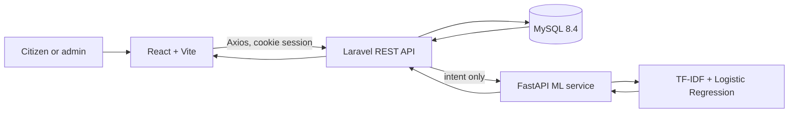

# SevaSetu — AI-Enhanced E-Governance Chatbot

SevaSetu is an English, Hindi, and Hinglish information portal for common Indian public-service topics. Citizens can browse service guides and FAQs, ask questions in a chatbot, and save their chat history by creating an account. Administrators can manage the catalogue and review database-backed usage analytics.

This is an academic information project, not a government website. It does not submit applications, verify identities, approve benefits, or process payments. Its catalogue contains concise English and Hindi summaries plus Roman-script Hinglish variants linked to official government sources; users should confirm current requirements with the linked department, especially for state-specific services.

## Features

- Responsive React/Vite public pages, service directory, FAQs, and chatbot with English, Hindi, and Hinglish answers.
- Citizen signup, login, profile and password updates, password reset by email log, and personal chat history.
- Separate admin login, role-protected APIs, service and FAQ CRUD, citizen status management, conversation review, and live analytics.
- Laravel 13 REST API with Sanctum cookie/session authentication and MySQL persistence.
- A separate FastAPI intent service using TF-IDF and Logistic Regression. Laravel remains the chatbot orchestrator and retrieves answers from MySQL.
- Rule-based matching continues to work if the Python service is unavailable.

## Architecture



React communicates only with Laravel. The Python service classifies intent; it does not generate answers. Laravel retrieves intent-matched scheme guides and FAQs, including their official source links, from MySQL. Low-confidence or unknown queries keep the safe fallback.

## Project layout

```text
backend/       Laravel 13 API, migrations, seeders, feature tests
frontend/      React 19, Vite, Tailwind CSS, Axios, React Router
ml-service/    FastAPI, scikit-learn training and inference service
```

## Prerequisites

The project was initialized with PHP 8.5.12, Composer 2.11.1, Node.js 26.13.0 / npm 11.20.0, Python 3.13.17, Git 2.56.0, and the existing MySQL 8.4 Windows service. No XAMPP database is used. Laravel requires PHP 8.3 or newer; the installed PHP extensions include `pdo_mysql`, `pdo_sqlite`, `mbstring`, `curl`, `openssl`, and `fileinfo`.

Open PowerShell in the project root:

```powershell
Set-Location 'C:\Full Stack Projects\e-governance-chatbot'
```

If a command is not on `PATH` in a new terminal, use the supplied Herd Lite PHP/Composer and Python paths:

```powershell
& 'C:\Users\ritur\.config\herd-lite\bin\php.exe' --version
& 'C:\Users\ritur\.config\herd-lite\bin\composer.bat' --version
& 'C:\Users\ritur\AppData\Local\Programs\Python\Python313\python.exe' --version
& 'C:\Program Files\nodejs\node.exe' --version
& 'C:\Program Files\nodejs\npm.cmd' --version
```

The project commands below assume PHP/Composer/Python are available on `PATH`; otherwise use their full paths.

## MySQL setup

Start the existing `MySQL84` service. This Windows setup uses the existing MySQL Workbench connection `root@127.0.0.1:3306`; no MySQL users are created or modified. The local `e_governance` database is already migrated and seeded. If setting up a fresh machine and the project database does not exist, run this in Workbench:

```sql
CREATE DATABASE IF NOT EXISTS e_governance
  CHARACTER SET utf8mb4 COLLATE utf8mb4_unicode_ci;
```

`backend/.env` is ignored by Git and holds the existing local root password. Never share or commit the actual value. The connection fields are:

```dotenv
DB_CONNECTION=mysql
DB_HOST=127.0.0.1
DB_PORT=3306
DB_DATABASE=e_governance
DB_USERNAME=root
DB_PASSWORD=your_local_mysql_password
```

The repository's `backend/.env.example` contains a placeholder password for fresh setups only.

## Backend setup

From the project root:

```powershell
Set-Location .\backend
composer install
```

The initialized local `backend/.env` and application key are already present. For a fresh clone, copy `.env.example` to `.env` only if `.env` does not exist, then generate a key:

```powershell
if (-not (Test-Path .env)) { Copy-Item .env.example .env }
php artisan key:generate
```

For a fresh database, apply the migrations and seed the catalogue:

```powershell
php artisan migrate --seed
```

The seed provides 10 service guides and 30 FAQs with English, Hindi, and Hinglish content, including source links. Hinglish text is stored on existing catalogue entries; no extra translation rows are needed. It avoids universal document checklists or unsupported eligibility rules. Ration Card answers direct users to their own State/UT portal because criteria and application procedures differ by state.

### Catalogue sources

The seeded answers were checked against official government sources:

- Aadhaar: [UIDAI enrolment and updates](https://uidai.gov.in/en/enrolment-and-updates) and [Aadhaar Seva Kendra](https://uidai.gov.in/en/aadhaar-seva-kendra).
- PAN: [Income Tax Department forms](https://www.incometax.gov.in/iec/foportal/help/all-topics/e-filing-services/income-tax-forms) and the Government’s [PAN 2.0 FAQ](https://static.pib.gov.in/WriteReadData/specificdocs/documents/2024/nov/doc20241127454301.pdf).
- Ration Card: [NFSA application guidance](https://nfsa.gov.in/portal/apply) and [State/UT ration-card portals](https://www.nfsa.gov.in/portal/Ration_Card_State_Portals_).
- PM-KISAN: [official scheme portal](https://pmkisan.gov.in/).
- Scholarships: [National Scholarship Portal](https://scholarships.gov.in/Students), [scheme list](https://scholarships.gov.in/All-Scholarships), and [OTR guidance](https://scholarships.gov.in/otrapplication/).
- General services: [Services section of the National Portal of India](https://www.india.gov.in/services).
- Passport: [Passport Seva application guidance](https://passportindia.gov.in/psp/apply).
- Voter services: [Election Commission of India Citizen Service Portal](https://voters.eci.gov.in/).
- DigiLocker: [official DigiLocker portal](https://www.digilocker.gov.in/).
- UMANG: [MeitY/NeGD About UMANG](https://www.umang.gov.in/landing/aboutus).

For an existing database, run `php artisan migrate` to add Hinglish fields to the existing guide, FAQ, and chat-history tables. This migration updates existing English catalogue entries with Hinglish content; it does not insert catalogue rows or reset the database. The seeder also defines Hinglish variants for fresh installations.

### Admin account

There is no public admin registration. An admin account has been provisioned in this local database using the values in the ignored `backend/.env`; sign in at `/admin/login` with those local values. Do not copy the password into this README or source control.

For a fresh setup or to apply changed admin details, set `ADMIN_NAME`, `ADMIN_EMAIL`, and `ADMIN_PASSWORD` in `backend/.env` (the password must satisfy the application's password rules), then run from `backend/`:

```powershell
php artisan config:clear
php artisan db:seed --class=AdminSeeder
```

The seeder creates or updates the admin record matching `ADMIN_EMAIL`. No demo password is embedded in the source or README.

### Password reset

The local mailer is set to `log`. Use the forgot-password page; Laravel writes the reset email and its frontend reset link to `backend/storage/logs/laravel.log`. In production, configure a real mail transport.

## Frontend setup

From the project root:

```powershell
Set-Location .\frontend
Copy-Item .env.example .env.local
npm.cmd ci
npm.cmd run build
```

`VITE_API_URL` defaults to `http://localhost:8000`. Use `localhost` consistently for both frontend and backend so Sanctum's cookie-based SPA authentication works. The Vite server uses `http://localhost:5173`.

## Python ML service

From the project root:

```powershell
Set-Location .\ml-service
py -3.13 -m venv .venv
.\.venv\Scripts\python.exe -m pip install -r requirements.txt
.\.venv\Scripts\python.exe -m app.train
```

The virtual environment is local and ignored by Git. Training compares word n-grams with character n-grams on a stratified validation split, chooses the better macro-F1 result, selects a confidence threshold from validation predictions, then saves a test report and Joblib artifacts under `ml-service/models/`. The checked-in report and model are generated from the labelled dataset; rerun training after changing examples.

The FastAPI service exposes `GET /health` and `POST /predict` on port 8001. It returns an intent, model score, and confidence-threshold result. A score is not a guarantee that a prediction is correct.

### Current model evaluation

The labelled dataset currently has 242 unique examples, with 30 examples in each intent at minimum. A stratified 144/49/49 train, validation, and test split selected character n-grams: validation macro-F1 was 0.7016 for character features and 0.5791 for word features. On the held-out set of 49 examples, the generated report records 0.8776 accuracy, 0.9187 macro-precision, 0.8810 macro-recall, and 0.8823 macro-F1. The validation-selected confidence threshold is 0.225. This small educational test set is not a deployment accuracy guarantee. See [the generated report](ml-service/models/evaluation.json).

## Run the three services

Use three PowerShell terminals, each starting in the project root.

**Terminal 1 — Laravel API**

```powershell
cd backend
php artisan serve 
```

**Terminal 2 — Python intent API**

```powershell
cd ml-service
python -m uvicorn app.main:app --port 8001
```

**Terminal 3 — React app**

```powershell
cd frontend
npm run dev 
```

Open `http://localhost:5173`. The API health endpoints are `http://localhost:8000/up` and `http://127.0.0.1:8001/health`.

## API overview

| Area | Endpoints |
|---|---|
| Authentication | `POST /api/auth/register`, `/api/auth/login`, `/api/auth/logout`; `GET /api/auth/user`; forgot/reset password endpoints |
| Profile | `PATCH /api/profile`, `PUT /api/profile/password` |
| Catalogue | `GET /api/schemes`, `/api/schemes/search`, `/api/schemes/{id}`; `GET /api/faqs`, `/api/faqs/search` |
| Chat | `POST /api/chatbot/query`; authenticated `GET /api/chat-history`, `DELETE /api/chat-history/{id}` |
| Admin | `GET /api/admin/analytics`, `/users`, `/chat-history`; protected scheme and FAQ CRUD routes |
| ML | `GET /health`, `POST /predict` on port 8001; accessible to Laravel locally, never called by React |

All admin endpoints require an authenticated admin role. Citizen registration always assigns the `citizen` role on the backend.

## Tests and build checks

```powershell
# Laravel feature tests (uses in-memory SQLite)
Set-Location .\backend
php artisan test

# Python service and intent behavior
Set-Location ..\ml-service
.\.venv\Scripts\python.exe -m pytest

# Frontend production compilation
Set-Location ..\frontend
npm.cmd run build
```

Tests use SQLite and do not alter the MySQL database. Run `php artisan migrate --seed` only after pointing `.env` to the intended project database.

## Screenshots

Add screenshots here after starting the app locally.

## Troubleshooting

- **Database connection refused:** confirm the `MySQL84` service is running on port 3306 and check the existing root connection settings in `backend/.env`. The `.env.example` password is only a placeholder.
- **Unknown database/table:** create `e_governance`, then run `php artisan migrate --seed` from `backend/`.
- **Sanctum/CSRF errors:** open both apps using `localhost` (not a mix of `localhost` and `127.0.0.1`), check `SANCTUM_STATEFUL_DOMAINS`, `SESSION_DOMAIN`, CORS origins, and reload the frontend.
- **Chat works but ML is down:** verify `http://127.0.0.1:8001/health`. Rule-based matching continues; ambiguous requests use the fallback.
- **ML reports no model:** create the venv, install `requirements.txt`, and run `python -m app.train` inside `ml-service/`.
- **Composer reports GitHub API rate limits:** the warning alone does not require a token. Use normal Packagist distribution archives; only address a token if a specific download is blocked.
- **Frontend npm commands:** use `npm.cmd` in PowerShell if script execution policy blocks `npm.ps1`.

## Known limitations

- Government requirements and portal content can change. The linked official source is authoritative; the catalogue is an informational summary and does not replace the department’s current instructions.
- The intent model is a small educational classifier trained on a limited hand-labelled dataset. Add reviewed examples for local wording and evaluate it again before deployment.
- Password reset is logged locally; production email delivery and operational hardening are deployment tasks.
- This project is informational and does not integrate with government identity, application, approval, or payment systems.
